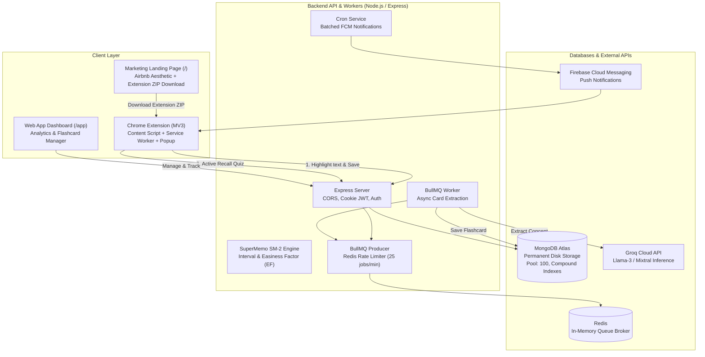

# Ormayundo (Rewire) 🧠

> **Transform passive reading into permanent, retrievable knowledge.**  
> Highlight any sentence, code snippet, or article on the web. Ormayundo turns it into high-yield active recall flashcards powered by Groq Llama-3 and schedules it with the **SuperMemo SM-2** spaced repetition algorithm.

---

## 📌 Table of Contents
- [About the Project](#-about-the-project)
- [How Storage Works (Are We Using RAM to Store Cards?)](#-how-storage-works-are-we-using-ram-to-store-cards)
- [System Architecture](#-system-architecture)
- [Key Features](#-key-features)
- [Tech Stack](#-tech-stack)
- [Project Structure](#-project-structure)
- [Getting Started](#-getting-started)
  - [Prerequisites](#prerequisites)
  - [1. Backend Setup](#1-backend-setup-server)
  - [2. Web Client Setup](#2-web-client-setup-client)
  - [3. Chrome Extension Setup](#3-chrome-extension-setup-extension)
- [Environment Variables](#-environment-variables)
- [API Reference](#-api-reference)
- [Spaced Repetition Algorithm (SuperMemo SM-2)](#-spaced-repetition-algorithm-supermemo-sm-2)
- [Production & Scalability](#-production--scalability)
- [License](#-license)

---

## 💡 About the Project

**Ormayundo** (*Malayalam: ഓർമ്മയുണ്ടോ? — "Do you remember?"*) was built to conquer the **Ebbinghaus Forgetting Curve**. Most readers forget 70% of what they read within 48 hours. 

Ormayundo eliminates the friction of copying and pasting text into flashcard apps:
1. **Highlight text** on any website (MDN, Wikipedia, GitHub, documentation, blogs).
2. Tap the floating **"Save to Ormayundo"** button.
3. In the background, **Groq AI (Llama-3)** formulates a conceptual active recall question, extracts tables/code into clean markdown, and files it into a categorized deck.
4. Review due flashcards in-browser via the **Chrome Extension popup** or track long-term memory mastery in the **Web Brain Dashboard**.

---

## 🗄️ How Storage Works (Are We Using RAM to Store Cards?)

> **No, flashcards are NOT stored in RAM (memory). All flashcards are permanently stored on disk in MongoDB.**

Here is the exact storage architecture across the system:

| Layer | Technology | Storage Type | Purpose in Ormayundo |
| :--- | :--- | :--- | :--- |
| **Primary Database** | **MongoDB Atlas / MongoDB** | **Permanent Disk Storage** | **Stores all flashcards (`RecallItem`), categorized decks (`Deck`), user profiles, and review histories.** Data persists permanently across server restarts and crashes. |
| **Asynchronous Queue** | **Redis (Upstash / Local)** | **In-Memory (RAM) Queue Broker** | **Used ONLY as a temporary message queue (BullMQ)** for asynchronous AI generation jobs, Groq rate-limiting (25 requests/min), and notification mutex locks. **Cards are not stored in Redis.** |
| **Browser Extension** | `chrome.storage.local` + React State | Local Browser Disk & Transient RAM | Caches auth tokens and popup UI states. Cards due for review are fetched on demand from the MongoDB API over HTTPS. |

If the server, Redis, or computer restarts, **zero flashcards are lost** because MongoDB guarantees durable disk persistence.

---

## 🏗️ System Architecture



---

## ✨ Key Features

### 1. In-Browser Highlight & Capture (Chrome Extension MV3)
- **Automatic Floating Trigger**: Highlighting text on any page presents an instant, non-intrusive **"Save to Ormayundo"** button directly next to the cursor.
- **Context-Menu Integration**: Right-click any selection to save immediately.
- **Context Extraction**: Captures selected text, surrounding paragraph context, page title, and canonical URL.

### 2. Conceptual AI Synthesis (Groq Llama-3)
- Rather than verbatim question/answer duplication, the AI formulates **conceptual active-recall prompts** that test underlying understanding.
- **Markdown & Tables**: Extracts tabular comparisons (e.g. database index types) and code blocks with syntax highlighting.
- **Automatic Deck Categorization**: Files cards into contextual decks (`Nodejs & express`, `javascript`, `noSql`, `dsa`, `sql`, `wikipedia`, etc.).

### 3. SuperMemo SM-2 Spaced Repetition Engine
- Dynamically schedules cards according to recall difficulty:
  - **Forgot (Grade 1)**: `< 1 minute` (re-enters immediate study queue).
  - **Hard (Grade 2)**: `2 days` (conservative interval, decreases Easiness Factor).
  - **Good (Grade 4)**: `6 days` (standard SM-2 progression).
  - **Easy (Grade 5)**: `8 days` + `1.3x` Easy Bonus multiplier.
- Calculates memory decay dynamically, preventing card backlogs.

### 4. Interactive In-Tab Extension Popup
- Review due cards without context switching away from your active work tab.
- 3D card-flip animations with built-in Web Audio synthesis chimes for sound feedback.
- Configurable **Auto-Popup** toggle to remind you when cards are due.

### 5. Web Brain Dashboard (`/app` or `/dashboard`)
- **Knowledge Mastery Donut**: Color-coded visualization of your entire deck (`Learning`, `Mastered`, `New`, `Relearning`).
- **Upcoming Workload Forecast**: Daily review workload bars (Today, Tomorrow, In 3 Days, Next Week).
- **Streak & Retention Analytics**: Real-time memory retention scoring (e.g., 77%) and study streak tracking.
- **30-Day Activity Heatmap**: GitHub-style heatmap tracking consistency.

### 6. Multi-Deck Flashcard Manager
- Filter by topic decks with real card counts.
- Search cards in real-time by keyword or concept.
- Edit card questions, answers, decks, or delete with one click.

### 7. Standalone Airbnb-Style Landing Page (`/`)
- Distinct route and layout featuring the Airbnb Rausch (`#FF385C`) design system.
- Direct download button for `ormayundo-extension.zip`.
- High-resolution showcase featuring real extension and dashboard screenshots.

---

## 🛠️ Tech Stack

- **Frontend**: React 18, Vite, Tailwind CSS, Lucide React, Chart.js / Recharts.
- **Chrome Extension**: Manifest V3, Webpack / Vite, Web Audio API, Firebase Cloud Messaging.
- **Backend**: Node.js, Express.js, Mongoose, Cookie-Parser, CORS.
- **Database**: MongoDB (Atlas) with compound indexing and connection pooling (`maxPoolSize: 100`).
- **Message Queue & Cache**: Redis, BullMQ.
- **AI Engine**: Groq Cloud SDK (Llama-3 / Mixtral).
- **Authentication**: Google OAuth 2.0, HTTP-only JWT cookies.

---

## 📁 Project Structure

```
rewire/
├── client/                     # React Vite Frontend (Web App & Landing Page)
│   ├── public/
│   │   ├── images/             # Product screenshots & feature crops
│   │   └── ormayundo-extension.zip # Built unpacked extension download
│   ├── src/
│   │   ├── AnalyticsDashboard.jsx # Brain analytics & mastery donut
│   │   ├── FlashcardManager.jsx   # Decks & card management table
│   │   ├── LandingPage.jsx        # Airbnb-style marketing page
│   │   ├── App.jsx                # Client-side router & layout isolation
│   │   ├── Auth.jsx               # Google / JWT login
│   │   └── config.js              # API URLs
│   └── package.json
│
├── extension/                  # Chrome Extension (Manifest V3)
│   ├── public/
│   │   ├── manifest.json       # Chrome MV3 manifest configuration
│   │   ├── content.js          # DOM text highlight listener & floating pill
│   │   └── background.js       # Service worker & FCM listener
│   ├── src/
│   │   ├── components/Dashboard.jsx # Extension popup flashcard review
│   │   └── services/spacedRepetition.js # Client-side SM-2 math helper
│   └── package.json
│
├── server/                     # Node.js / Express Backend
│   ├── config/
│   │   └── db.js               # MongoDB pool (100 connections)
│   ├── src/
│   │   ├── config/redis.js     # Redis singleton & BullMQ client
│   │   ├── controllers/        # Auth, Recall, Decks, Analytics
│   │   ├── models/             # Mongoose schemas (RecallItem, Deck, User)
│   │   ├── routes/             # REST API endpoints
│   │   ├── services/
│   │   │   ├── aiService.js    # Groq prompt formatting & validation
│   │   │   ├── spacedRepetitionService.js # SM-2 server logic
│   │   │   └── pushService.js  # FCM push notifications & cron jobs
│   │   └── workers/
│   │       └── aiWorker.js     # BullMQ asynchronous queue worker
│   ├── app.js                  # Express setup, graceful shutdown
│   └── package.json
│
└── README.md
```

---

## 🚀 Getting Started

### Prerequisites
- [Node.js](https://nodejs.org/) (v18 or higher recommended)
- [MongoDB](https://www.mongodb.com/) (Local instance or MongoDB Atlas URI)
- [Redis](https://redis.io/) (Local Redis or cloud service like Upstash)
- [Groq API Key](https://console.groq.com/) for fast AI inference

---

### 1. Backend Setup (`server`)

1. Navigate to the `server` directory:
   ```bash
   cd server
   npm install
   ```

2. Create a `.env` file in `server/.env`:
   ```env
   PORT=5000
   NODE_ENV=development
   MONGODB_URI=mongodb+srv://<username>:<password>@cluster.mongodb.net/ormayundo?retryWrites=true&w=majority
   REDIS_URL=redis://localhost:6379
   JWT_SECRET=your_jwt_secret_key_here
   REFRESH_TOKEN_SECRET=your_refresh_token_secret_key_here
   AI_API_KEY=gsk_your_groq_api_key_here
   ```

3. Start the backend development server:
   ```bash
   npm run dev
   ```
   *The server runs at `http://localhost:5000` with automated DB connection pooling and background workers.*

---

### 2. Web Client Setup (`client`)

1. Navigate to the `client` directory:
   ```bash
   cd client
   npm install
   ```

2. Start the Vite development server:
   ```bash
   npm run dev
   ```

3. Open `http://localhost:5173`:
   - `/`: Marketing Landing Page with product showcase and Extension ZIP download.
   - `/app` or `/dashboard`: The authenticated Brain Dashboard & Flashcard Manager.

4. To build for production:
   ```bash
   npm run build
   ```

---

### 3. Chrome Extension Setup (`extension`)

1. Navigate to the `extension` directory and install dependencies:
   ```bash
   cd extension
   npm install
   ```

2. Build the extension bundle:
   ```bash
   npm run build
   ```

3. Load the extension in Google Chrome:
   - Open Chrome and navigate to `chrome://extensions`.
   - Enable **Developer mode** (toggle in the top-right corner).
   - Click **Load unpacked**.
   - Select the `extension/dist` folder (or extracted `ormayundo-extension.zip`).
   - The Ormayundo brain icon will now appear in your browser toolbar!

---

## 🔑 Environment Variables Reference

| Variable | Location | Description |
| :--- | :--- | :--- |
| `PORT` | `server/.env` | Port on which the Express server listens (default: `5000`). |
| `MONGODB_URI` | `server/.env` | Connection string for MongoDB (includes pool settings). |
| `REDIS_URL` | `server/.env` | Connection URI for Redis (used for BullMQ & rate limiting). |
| `AI_API_KEY` | `server/.env` | Groq Cloud API key for Llama-3 card generation. |
| `JWT_SECRET` | `server/.env` | Secret key used to sign HTTP-only authentication tokens. |
| `REFRESH_TOKEN_SECRET` | `server/.env` | Secret key used to sign long-lived refresh tokens. |
| `NODE_ENV` | `server/.env` | Environment mode (`development` or `production`). |

---

## 📡 API Reference

### Authentication (`/api/auth`)
- `POST /api/auth/google`: Authenticate with Google OAuth token.
- `GET /api/auth/me`: Lightweight session check returning user status.
- `POST /api/auth/logout`: Clears HTTP-only cookies and ends session.

### Active Recall & Flashcards (`/api/recall`)
- `POST /api/recall/generate`: Queue selected text for AI question synthesis.
- `GET /api/recall/due`: Fetch cards scheduled for review right now (`nextReviewDate <= now`).
- `POST /api/recall/review`: Submit an SM-2 grade rating (`Forgot`, `Hard`, `Good`, `Easy`) to reschedule.
- `GET /api/recall/cards`: Fetch all cards with optional deck and search filters.
- `DELETE /api/recall/wipe`: Wipe all user cards.

### Decks (`/api/decks`)
- `GET /api/decks`: List all decks and card counts for the authenticated user.
- `POST /api/decks`: Create a new custom deck.

### Analytics (`/api/analytics`)
- `GET /api/analytics/dashboard`: Returns retention rate, creation streak, mastery breakdown, and workload forecasts.

---

## 📐 Spaced Repetition Algorithm (SuperMemo SM-2)

The engine implements the standard **SuperMemo SM-2** formulation:

$$\text{EF}' = \text{EF} + (0.1 - (5 - q) \times (0.08 + (5 - q) \times 0.02))$$

- **$q$ (Grade)**: Performance rating from 1 to 5:
  - `Forgot` ($q=1$): Resets repetitions to `0`; interval `< 1 minute`.
  - `Hard` ($q=2$): Interval = `2 days`; Easiness Factor decreases.
  - `Good` ($q=4$): Interval = `6 days`; standard SM-2 progression.
  - `Easy` ($q=5$): Interval = `8 days` + `1.3x` Easy Bonus multiplier.
- **$\text{EF}$ (Easiness Factor)**: Initialized at `2.5`. Bounded to a minimum of `1.3` to avoid learning lockouts.

---

## ⚡ Production & Scalability

Ormayundo is engineered for high concurrency and resilience:
1. **High Concurrency Database Pool**: MongoDB connection pool configured with `maxPoolSize: 100` and `minPoolSize: 10` for fast concurrent lookups.
2. **Compound Indexing**: Compound indexes on `{ userId: 1, nextReviewDate: 1 }` and `{ userId: 1, deckId: 1 }` ensure instantaneous due queries even with tens of thousands of cards.
3. **Queue Rate-Limiting**: BullMQ throttles background AI jobs to **25 requests/min**, preventing Groq 429 rate-limit errors.
4. **Graceful Zero-Downtime Shutdown**: `server/app.js` listens for `SIGINT`, `SIGTERM`, and `SIGUSR2`, shutting down the HTTP listener, finishing active BullMQ jobs, and closing Redis and MongoDB pools with a 10-second watchdog timer.
5. **Keep-Warm Endpoint**: `/api/ping` endpoint compatible with free-tier uptime monitors (e.g., cron-job.org or UptimeRobot) to eliminate container cold starts.

---

## 📄 License

This project is licensed under the MIT License — see the [PRIVACY.md](PRIVACY.md) file for terms and privacy commitments.

